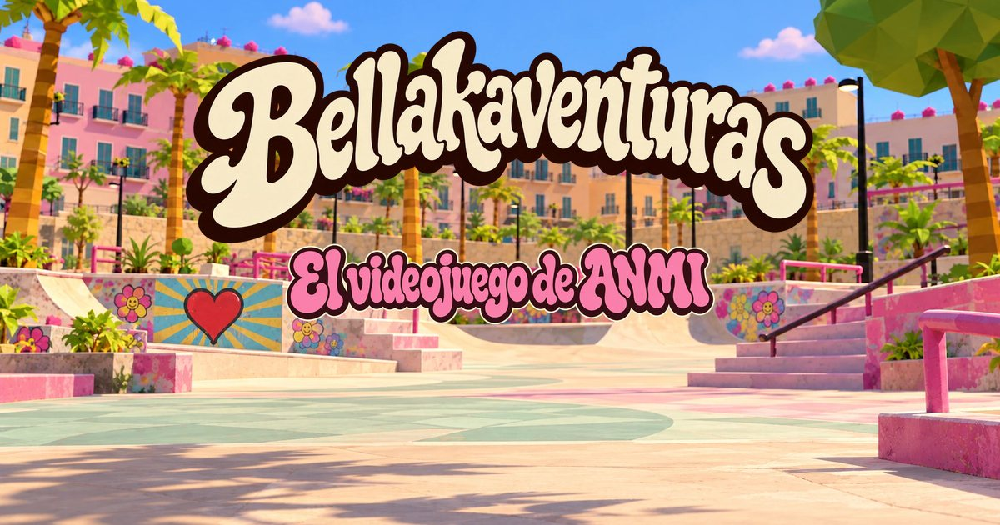

# Bellakaventuras · el videojuego de ANMI



Juego web 3D de skate del proyecto *Bellakaciones* de ANMI. Se juega en el navegador, sin instalar nada, en el móvil (vertical u horizontal), en el ordenador o con mando.

Estuvo en www.bellakaventuras.com del **24 de octubre al 7 de noviembre de 2026**.

**Tráiler:** [trailer/trailer-bellakaventuras.mp4](trailer/trailer-bellakaventuras.mp4) (54 s) · **Historia para redes:** [trailer/historia-bellakaventuras.mp4](trailer/historia-bellakaventuras.mp4) (30 s)

## El juego

- ANMI patina por un parque con **cinco escenarios**, y cada uno suena con una canción del proyecto.
- Hay **20 patatas** escondidas y **cinco actividades**: dos charlas con personajes, un tutorial de grind, un grafiti y un combo de baile.
- El final es el reto de **SECRETNOVIO**, con escena de cierre.
- Tiene **cronómetro de speedrun** con un **top 3 compartido** por todos los jugadores, que se actualizaba solo y sin nombres.
- Diálogos ilustrados en 2D, modo de ayuda, guardado automático y controles táctiles, de teclado y de mando.

## Cómo está hecho

| Parte | Tecnología |
|---|---|
| Motor | three.js (render), Rapier (colisiones y física), TypeScript, Vite |
| Personajes y objetos | Modelos generados con Meshy, procesados en Blender (esqueleto y animaciones de skate propias) y optimizados para web (glTF comprimido, texturas WebP) |
| Carga | Barra de progreso que mide lo que de verdad falta por descargar |
| Servidor | VPS propio con Ubuntu y Caddy, con la CDN de Bunny delante (82 % de las peticiones servidas desde su caché) |
| Métricas | Sistema propio y anónimo: el juego manda avisos sin datos personales y el servidor los resume sin guardar IP |
| Vigilancia | Avisos al móvil, autocuración del servidor y vuelta atrás de versión con un comando |
| Calidad | Batería de pruebas automáticas en navegador (Chrome, Safari y Firefox, con formatos de móvil emulados), incluida una partida entera jugada por un piloto automático |

## Probarlo

En [`juego/`](juego/) está el juego **compilado**, tal y como se servía en la web. Basta con abrirlo desde cualquier servidor web estático, por ejemplo:

```bash
python3 -m http.server 8000 --directory juego
```

Después, abre http://localhost:8000. El cronómetro y el top 3 necesitaban el servidor original; sin él, el juego funciona igual pero no muestra el récord.

## Créditos

Diseño y desarrollo: **Noel Pedrosa Alba** · Proyecto y música: **ANMI** · Creativo: **Joan Because** · Colaboradores: **La Mano de Oro**, **Adrián Rodríguez**

## Licencia

**Todos los derechos reservados.** El juego, la música, los personajes, los logos y el arte se publican aquí para verlos y probarlos, no para reutilizarlos. Las librerías y tipografías de terceros que van dentro del juego conservan su propia licencia; sus textos están en [`licencias-terceros/`](licencias-terceros/).
